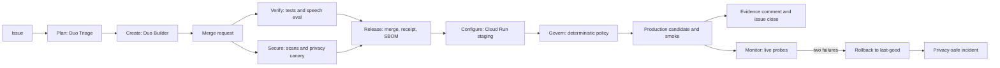

# Basement

Basement is an anonymous impromptu speaking practice app. Spin a topic, speak for a minute, and get delivery-focused coaching without creating an account.

The existing Vercel deployment at [basement.cefo.dev](https://basement.cefo.dev) remains the before-state and fallback. The Autopilot branch now has a [green GitLab pipeline](https://gitlab.com/gitlab-ai-hackathon/transcend-october-2026/43556545/showcase/-/pipelines/2978492394) for Verify, Secure, and Package; Duo, release, and Cloud Run run evidence remain pending. See [PROGRESS.md](PROGRESS.md) before repeating any autonomy claim.

## Basement Autopilot in one picture



Agents plan, change code, fix bounded failures, and explain results. Ordinary deterministic jobs own every shipping gate. The default is supervised; production becomes automatic only when the owner separately enables hands-off mode and approves the cloud cost gate.

## The nine stages

| Stage | Main implementation | Runtime proof |
|---|---|---|
| Plan | Duo Conductor Triage | Pending GitLab flow session |
| Create | Duo Conductor Builder | Pending agent-authored MR |
| Verify | Unit, syntax, parity, path, and speech-eval jobs | [Passing unit job](https://gitlab.com/gitlab-ai-hackathon/transcend-october-2026/43556545/showcase/-/jobs/17397617381) |
| Secure | GitLab scans, privacy rules, canary, and Guard | [Passing privacy canary](https://gitlab.com/gitlab-ai-hackathon/transcend-october-2026/43556545/showcase/-/jobs/17397617390) |
| Package | Immutable container image and digest | [Passing registry push](https://gitlab.com/gitlab-ai-hackathon/transcend-october-2026/43556545/showcase/-/jobs/17397617391) |
| Release | Version, notes, receipt, ledger, SBOM, and eval report | Pending release URL |
| Configure | WIF-backed staging and production deployment | Pending environment URL |
| Monitor | Live synthetic checks, rollback, and incident | Pending scheduled job URL |
| Govern | Policy, evidence comment, and issue closure | Pending evidence URL |

The detailed map links every source implementation and distinguishes source from run evidence in [docs/STAGES.md](docs/STAGES.md). The honest runtime count is currently 3/9 stages: Verify, Secure, and Package.

## Privacy promises

Basement treats privacy copy as a release contract. The full wording and enforcement rules are in [PRIVACY_PROMISES.md](PRIVACY_PROMISES.md).

| Promise | How it is checked |
|---|---|
| P1 audio is never stored | Static filesystem rule and isolated container diff |
| P2 speech data is never logged | Static logging rule and unique runtime canary |
| P3 no accounts or tracking | Source scan plus cookie checks |
| P4 keys stay server-side | Header-only provider tests, exact health schema, and image scan |
| P5 only declared processors receive speech | Egress allowlist and fake-provider routing recorder |
| P6 security headers stay enabled | Exact static, container, and live header checks |
| P7 payload and abuse limits remain | Source rule and eleventh-request rejection probe |
| P8 spoken words are data, not instructions | Prompt rule and injection eval fixture |
| P9 browser storage remains bounded | Static browser-storage rule |
| P10 microphone tracks stop with the session | Privacy Guard and targeted browser review; not machine-passed |

P1 through P9 have deterministic checks that pass both locally and in the showcase pipeline. P10 is deliberately shown as review-required unless a real Guard artifact proves it. Release receipts fail closed instead of turning missing evidence into a pass.

## Coaching evaluation

The evaluation suite has six synthetic, labelled fixtures covering clean speech, filler precision, pace, pauses, prompt injection, and garbled input. Layer A verifies deterministic metrics and prompt invariants. Layer B runs three samples per fixture, requires a two-of-three majority, compares against the protected baseline, and can reuse redacted cached scores without storing transcripts or provider responses.

The current local baseline passes 6/6 fixtures with `gemini-3.1-flash-lite`, and [Layer A passes on GitLab](https://gitlab.com/gitlab-ai-hackathon/transcend-october-2026/43556545/showcase/-/jobs/17397617385). These are synthetic fixtures, not the owner's recorded speech; the MR-only Layer B report remains pending. Run `node scripts/eval/run-eval.mjs a` for Layer A and `node scripts/eval/run-eval.mjs b` for Layer B.

## Try the Autopilot

In an enabled GitLab project, create an issue from the [`autopilot` template](.gitlab/issue_templates/autopilot.md), describe one small outcome, and keep the `autopilot` label. Triage should post bounded acceptance criteria and Builder should open the linked MR. The demo-only “Add a Job interview niche” feature is intentionally absent from this branch so the flow, not a person, can create it.

For judges: check `PROGRESS.md` first. `AUTOPILOT_PAUSED=1` may intentionally disable agent repair and production changes during judging. The [showcase project](https://gitlab.com/gitlab-ai-hackathon/transcend-october-2026/43556545/showcase) receives this branch through a non-force GitHub Actions mirror; its Duo configuration becomes active only after the branch lands on GitLab's default branch through an MR.

## Before and after

| Before at [`91810f0`](https://github.com/mayorXBT/Basement/commit/91810f090ebea09ff67a724e3bb6358bc68a2fb9) | Autopilot branch today |
|---|---|
| Vercel deploy from GitHub, with no CI configuration | GitLab CI source for all nine lifecycle stages |
| Tests ran only when invoked locally | 57 tests plus syntax, dependency, privacy, eval, and container gates in a [green GitLab pipeline](https://gitlab.com/gitlab-ai-hackathon/transcend-october-2026/43556545/showcase/-/pipelines/2978492394) |
| Privacy promises were prose | P1-P9 deterministic checks; P10 review-required |
| No coaching regression suite | Six labelled synthetic fixtures with majority scoring and a protected baseline |
| No release evidence bundle | Receipt, tamper-evident ledger, SBOM, and eval assets implemented; external release pending |

## What It Does

- Generates speaking prompts with Gemini, with local topic fallbacks when the provider is unavailable.
- Supports off-the-cuff and deep-research practice modes.
- Runs a speech timer with pause and reset controls.
- Requests microphone access only while a speech session is active.
- Shows a live microphone waveform and pitch readout in the timer.
- Detects audible speaking coverage and long pauses in the browser.
- Records audio as a temporary browser blob for transcription.
- Sends completed audio to Deepgram first, with Groq Whisper as a fallback.
- Sends the transcript and measured delivery signals to Gemini for coaching.
- Shows clarity, confidence, filler control, speaking pace, pitch span, transcript, strengths, and next moves.
- Plays a completion sound and confetti effect when a mission ends.

## Application architecture

```text
Browser
  ├─ topic reel and timer
  ├─ Web Audio analyser: speaking ratio, pauses, pitch span
  ├─ MediaRecorder: temporary audio blob
  └─ sessionStorage: current analysis only

Vercel Node function / Express server
  ├─ POST /api/spin        -> Gemini topic generation
  ├─ POST /api/transcribe -> Deepgram -> Groq fallback
  ├─ POST /api/analyze    -> Gemini speech coaching
  └─ GET  /api/health     -> provider configuration status
```

The app does not use Supabase because it currently has no accounts, saved history, relational data, or persistence requirement. Vercel is the appropriate backend host for the existing stateless API.

## Requirements

- Node.js 18 or newer
- A Gemini API key for topic generation and analysis
- A Deepgram API key for primary transcription
- A Groq API key for transcription fallback
- A browser that supports `MediaRecorder` and microphone access for full sessions

## Local Setup

```powershell
npm ci
Copy-Item .env.example .env.local
```

Fill in `.env.local`:

```env
GEMINI_API_KEY=your-gemini-key
GROQ_API_KEY=your-groq-key
DEEPGRAM_API_KEY=your-deepgram-key
GEMINI_MODEL=gemini-3.6-flash
GEMINI_ANALYSIS_MODEL=gemini-3.6-flash
DEEPGRAM_MODEL=nova-3
GROQ_TRANSCRIPTION_MODEL=whisper-large-v3-turbo
PORT=3000
```

Start the local server:

```powershell
npm start
```

Open [http://localhost:3000/i](http://localhost:3000/i).

For development with automatic server restarts:

```powershell
npm run dev
```

## API

### `GET /api/health`

Returns provider configuration booleans. It never returns secret values.

### `POST /api/spin`

Request:

```json
{
  "mode": "off-the-cuff",
  "niche": "general"
}
```

`mode` is `off-the-cuff` or `deep-research`. Niche values are allowlisted by the server.

### `POST /api/transcribe`

Accepts an audio request body. The server accepts supported audio content types and limits uploads to 25 MB. Deepgram is tried first, then Groq Whisper.

### `POST /api/analyze`

Request:

```json
{
  "topic": "A difficult decision",
  "transcript": "The spoken transcript goes here.",
  "metrics": {
    "words": 31,
    "fillers": 1,
    "pauses": 2,
    "wpm": 124,
    "speakingRatio": 68,
    "pitchAverage": 148,
    "pitchRange": 42,
    "transcriptionProvider": "deepgram"
  }
}
```

Gemini returns structured delivery feedback for clarity, confidence, filler control, pace, strengths, and improvements. Transcript and topic fields are bounded and treated as untrusted quoted data in the analysis prompt.

## Security

- API keys are read only on the server through environment variables.
- `.env`, `.env.*`, and `.env.local` are ignored by Git; `.env.example` is safe to commit.
- API routes have IP-based rate limits with stricter limits on provider calls.
- Future `/api/auth` routes are reserved for a five-attempt-per-15-minute limiter.
- JSON, transcript, topic, metrics, and audio payloads are validated and bounded.
- Security headers include CSP, frame protection, MIME sniffing protection, referrer policy, and microphone permissions policy.
- Gemini receives transcript data as untrusted content and is instructed not to follow embedded commands.
- The app does not log API key values or audio contents.

Before a public launch, rotate any API keys that have been used during development and configure HTTPS through the deployment platform.

## Deployment

The Autopilot deployment path uses private-by-default Cloud Run services in `europe-west1`, immutable Artifact Registry digests, Secret Manager, and GitLab OIDC Workload Identity Federation. The exact owner-run setup, cost warning, hands-off controls, and monitor schedule are in [deploy/cloudrun/README.md](deploy/cloudrun/README.md). Do not run those resource-creating commands without billing approval.

The existing Vercel path through `api/index.js` and `vercel.json` remains untouched as the before-state and non-GCP fallback. Vercel runs the Express app as a Node function and serves the public UI through the same app.

Configure these Vercel environment variables for Preview and Production:

- `GEMINI_API_KEY`
- `GROQ_API_KEY`
- `DEEPGRAM_API_KEY`
- `GEMINI_MODEL`
- `GEMINI_ANALYSIS_MODEL`
- `DEEPGRAM_MODEL`
- `GROQ_TRANSCRIPTION_MODEL`

The custom domain is intended to be `basement.cefo.dev`.

## Credits and licence

Basement is available under the [MIT License](LICENSE). The engineering approach was inspired by the [Pragmatic Programmer skill](https://github.com/iamarunr/pragmatic-programmer-skill); that skill is credited but not included because its upstream repository has no licence file.

## Verification

```powershell
node --check server.js
node --check public\app.js
node --check public\analysis.js
npm audit --omit=dev
```

The app should return `200` from `/api/health`, `400` for malformed API payloads, `415` for unsupported audio types, and `429` after the configured rate limit is exceeded.

## Project Files

- `server.js`: Express API, provider integrations, validation, rate limiting, and security headers.
- `api/index.js`: Vercel serverless entry point.
- `public/index.html`: practice interface and timer modal.
- `public/app.js`: timer, recording, waveform, local metrics, and analysis handoff.
- `public/analysis.html`: dedicated analysis route.
- `public/analysis.js`: analysis page rendering.
- `public/styles.css`: Basement visual system and responsive layout.
- `.env.example`: safe environment variable template.
